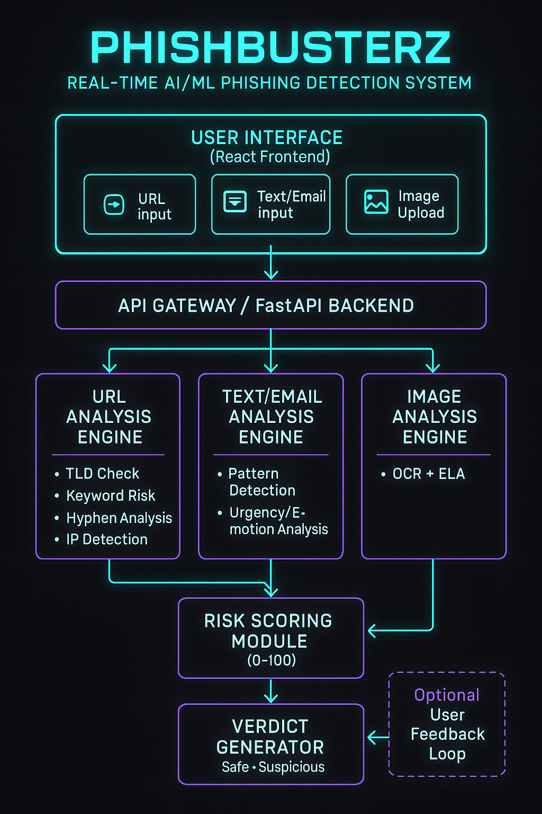
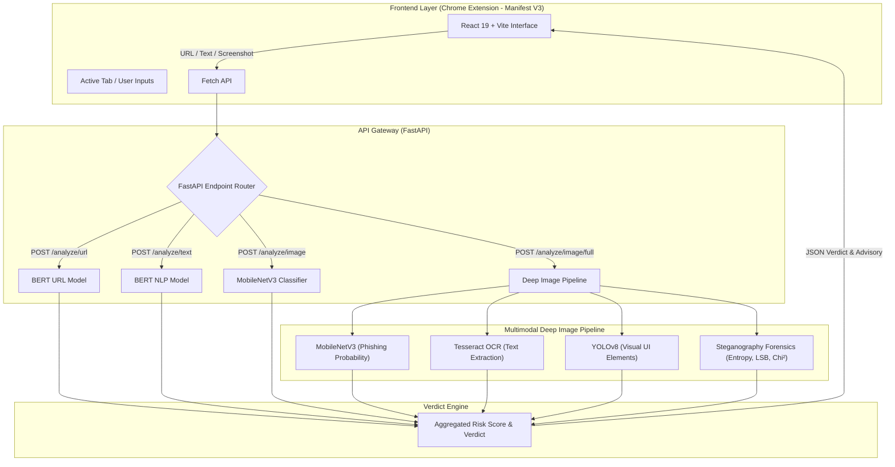
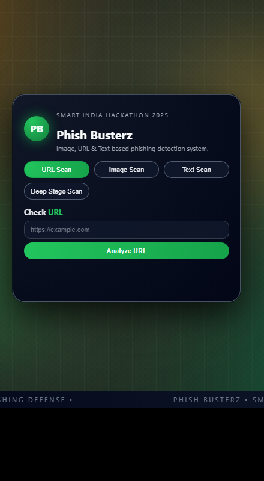
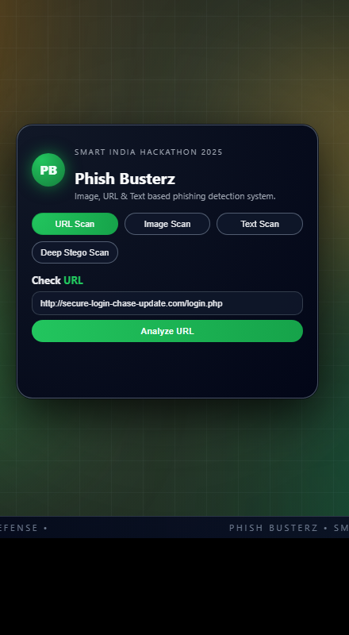
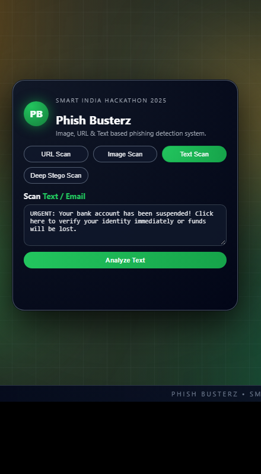
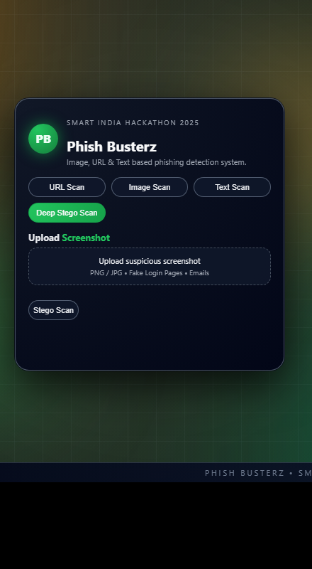

# PhishBusterz 👾
### *Multimodal AI-Powered Phishing & Threat Detection System*

[](https://www.sih.gov.in/)
[](#01-overview)
[](#01-overview)
[](https://python.org)
[](https://fastapi.tiangolo.com)
[](https://pytorch.org)
[](https://react.dev)
[](https://developer.chrome.com/docs/extensions/mv3/intro)

---

## ⚡ 60-Second Summary
> **PhishBusterz** is an end-to-end, multimodal cybersecurity solution engineered for **Smart India Hackathon (SIH 2025)** under **AICTE** (Problem Statement ID: **SIH25159**).  
> Unlike traditional blacklist- or regex-based detectors, PhishBusterz unifies **Natural Language Processing (Transformers/BERT)**, **Computer Vision (MobileNetV3 + YOLOv8)**, **Optical Character Recognition (Tesseract)**, and **Statistical Image Forensics (Steganography Detection)** to intercept zero-day phishing attacks across text, URLs, login screenshots, and weaponized images in real time via a lightweight browser extension.

---

## 📑 Project Details

| Parameter | Specification |
| :--- | :--- |
| **Problem Statement** | Real-Time AI/ML-Based Phishing Detection and Prevention System |
| **Problem Statement ID** | **SIH25159** |
| **Hackathon** | Smart India Hackathon (SIH) 2025 |
| **Theme** | Cybersecurity |
| **Nodal Organisation** | All India Council for Technical Education (AICTE) |

---

## Table of Contents
* [01. Overview](#01-overview)
* [02. Key Features](#02-key-features)
* [03. System Architecture](#03-system-architecture)
* [04. Technology Stack](#04-technology-stack)
* [05. Detection Methodology](#05-detection-methodology)
* [06. Application Screenshots](#06-application-screenshots)
* [07. Installation & Setup](#07-installation--setup)
* [08. API Reference](#08-api-reference)
* [09. Team & Contributions](#09-team--contributions)
* [10. Acknowledgements](#10-acknowledgements)

---

## 01. Overview

Phishing attacks have evolved far beyond standard typosquatting domains. Modern adversaries employ credential-harvesting visual replicas, zero-day email lures, evasive character homoglyphs, and weaponized images concealing malicious data inside pixel bit planes (steganography).

**PhishBusterz** solves this challenge by moving away from reactive blacklists to a **real-time multimodal AI inference pipeline**:
* Evaluates **semantic intent** rather than just domain age or registration records.
* Analyzes the **visual composition** of webpages and credential submission forms.
* Audits **image pixel distributions** to expose hidden payloads and covert channels.
* Delivers instant, non-intrusive threat warnings right inside the user's browser workflow.

---

## 02. Key Features

* 🔗 **Real-Time URL Threat Analysis:** Deep semantic domain & path evaluation using tokenized sequence classification to identify newly minted zero-day phishing links.
* ✉️ **Email & Social Engineering Text Scanner:** Contextual NLP parsing of message bodies to uncover urgency traps, authority spoofing, and credential harvesting lures.
* 🖼️ **Screenshot & Brand Impersonation Inspection:** Custom fine-tuned MobileNetV3 CNN classifies rendered webpage screenshots against known legitimate vs. fraudulent web interfaces.
* 🕵️ **Deep Steganography Diagnostics:** Tri-factor statistical analysis (Shannon Entropy, LSB proportion disparity, and Chi-Square distribution) identifying hidden payloads within image bit planes.
* 🎯 **UI Element Object Detection:** YOLOv8-powered localization of credential input boxes, brand emblems, and deceptive interface elements.
* ⚡ **Browser Extension (Manifest V3):** Low-latency React frontend integrated with Chrome Extension MV3 for real-time protection without degrading browsing speed.

---

## 03. System Architecture

<div align="center">
  
  <p><i>Figure 1: Official System Flowchart & High-Level Architecture Pipeline</i></p>
</div>



---

## 04. Technology Stack

### **Machine Learning & AI**
| Component | Technology | Purpose |
| :--- | :--- | :--- |
| **URL NLP** | `imanoop7/bert-phishing-detector` | Transformer classification of malicious URLs |
| **Email/Text NLP** | `ealvaradob/bert-finetuned-phishing` | Semantic threat analysis on email bodies |
| **Vision Classification** | `MobileNetV3-Small` (PyTorch) | Lightweight screenshot phishing classification |
| **Object Detection** | `Ultralytics YOLOv8` (`yolov8n.pt`) | Real-time detection of deceptive login UI components |
| **Text Extraction** | `PyTesseract` | Optical Character Recognition on image captures |
| **Steganography** | `NumPy` + `SciPy` | Pixel bit-plane and statistical entropy analysis |

### **Backend**
* **Framework:** FastAPI
* **Server:** Uvicorn ASGI
* **Deep Learning Runtime:** PyTorch 2.x, Torchvision, Hugging Face Transformers
* **Image Processing:** Pillow (PIL), OpenCV (`cv2`)

### **Frontend & Extension**
* **Framework:** React 19, JavaScript (ES6+)
* **Build Tool:** Vite
* **Target:** Google Chrome Extension (Manifest V3)
* **Styling:** Custom Cyberpunk / SIH Hackathon Theme

---

## 05. Detection Methodology

### 1. BERT Sequence Classification (URLs & Text)
* Tokenizes raw inputs using sub-word WordPiece tokenizers, neutralizing common obfuscation tricks (e.g., zero-width characters, homoglyphs).
* Applies Softmax cross-entropy to output logits:
  $$\text{Score} = \text{Softmax}(\text{Logits})_{\text{phish}}$$
* Triggers a `phishing` verdict when score exceeds threshold ($\tau = 0.60$).

### 2. Fine-Tuned MobileNetV3 (Visual Phishing)
* Employs `mobilenet_v3_small` pre-trained on ImageNet with a customized 2-class classification head (`Linear(1024, 2)`).
* Trained on curated legitimate vs. phishing login webpage screenshots, resized to $224 \times 224$ and normalized using ImageNet channel statistics.

### 3. YOLOv8 UI Element Detection
* Evaluates visual layouts to isolate credential entry fields, form containers, and brand emblems to verify whether an unverified domain is masquerading as a high-value login portal.

### 4. Tri-Factor Statistical Steganography Forensics
Analyzes image pixel matrices for hidden payloads without needing prior knowledge of the payload:
1. **Shannon Entropy ($H$):** Measures image information density. Abnormally low or unnatural entropy anomalies flag potential bit stuffing:
   $$H = -\sum_{i=0}^{255} P(x_i) \log_2 P(x_i)$$
2. **LSB Proportion Disparity:** Computes the ratio of odd vs. even bits across the Least Significant Bit plane; natural images exhibit variance, whereas sequential LSB injection shifts parity towards equality.
3. **Chi-Square ($\chi^2$) Goodness-of-Fit:** Evaluates frequency differences between pairs of values (PoVs) to detect bit-level manipulation.

---

## 06. Application Screenshots

| 01. Extension Overview & Mode Selector | 02. Real-Time URL Phishing Detection |
| :---: | :---: |
|  |  |
| *Active popup with SIH 2025 theme & mode switcher* | *Live BERT inference flagging zero-day phishing URL* |

| 03. Email Threat & Urgency NLP Scanner | 04. Deep Stego Screenshot Inspection |
| :---: | :---: |
|  |  |
| *Live NLP analysis detecting credential harvesting bait* | *Deep diagnostic upload zone for image & payload forensics* |

---

## 07. Installation & Setup

### Prerequisites
* **Python:** 3.11+ (or compatible 3.12–3.14)
* **Node.js:** v18+ & npm
* **Google Chrome** (or Chromium-based browser)
* *(Optional)* [Tesseract OCR Engine](https://github.com/tesseract-ocr/tesseract) installed on host OS.

---

### Step 1: Clone Repository
```bash
git clone https://github.com/Sneha-Nadar/phishingsih.git
cd phishingsih
```

---

### Step 2: Backend Setup (FastAPI)
```bash
# 1. Create and activate a Python virtual environment
python -m venv .venv

# On Windows:
.venv\Scripts\activate
# On Linux/macOS:
# source .venv/bin/activate

# 2. Install backend dependencies
pip install -r phishguard-extension/backend/requirements.txt
pip install pytesseract ultralytics opencv-python

# 3. Launch FastAPI server
cd phishguard-extension/backend
python -m uvicorn app:app --reload --port 8000
```
> The API will be live at `http://127.0.0.1:8000`. Interactive documentation is accessible at `http://127.0.0.1:8000/docs`.

---

### Step 3: Frontend & Extension Setup (React + Vite)
Open a **new terminal**:
```bash
# 1. Navigate to the extension folder
cd phishguard-extension

# 2. Install dependencies
npm install

# 3. Start local development server (to preview UI)
npm run dev
```

### Step 4: Load Extension into Chrome
1. Open Google Chrome and navigate to `chrome://extensions/`.
2. Turn on **Developer mode** in the top-right corner.
3. Click **Load unpacked** (top-left).
4. Select the `phishguard-extension` folder.
5. The **PhishBusterz** extension icon will now appear in your browser toolbar!

---

## 08. API Reference

### 1. `POST /analyze/url`
Analyzes a URL using the BERT transformer model.
* **Form-Data Param:** `url` (string)
* **Response:**
  ```json
  {
    "url": "https://secure-login-bank-verify.com",
    "score": 94,
    "verdict": "phishing"
  }
  ```

### 2. `POST /analyze/text`
Analyzes an email body or message for phishing keywords and social engineering signals.
* **Form-Data Param:** `body` (string)
* **Response:**
  ```json
  {
    "text": "Your account has been suspended. Click here immediately to restore access.",
    "score": 91,
    "verdict": "phishing"
  }
  ```

### 3. `POST /analyze/image`
Classifies a webpage screenshot using the fine-tuned MobileNetV3 model.
* **Form-Data Param:** `file` (UploadFile / image)
* **Response:**
  ```json
  {
    "phishing_prob": 88.45,
    "safe_prob": 11.55,
    "verdict": "phishing"
  }
  ```

### 4. `POST /analyze/image/full`
Executes deep multimodal diagnostic (MobileNetV3 + OCR + YOLOv8 + Steganography).
* **Form-Data Param:** `file` (UploadFile / image)
* **Response:**
  ```json
  {
    "mobilenet": {
      "phishing_prob": 0.88,
      "safe_prob": 0.12,
      "verdict": "phishing"
    },
    "ocr_text": "Enter your bank credentials to verify identity",
    "yolo_detections": [
      { "label": "login_field", "confidence": 0.92 }
    ],
    "stego_analysis": {
      "entropy": 7.42,
      "lsb_prop_diff": 0.082,
      "chi_square": 14205.3,
      "stego_detected": true
    },
    "final_verdict": "suspicious"
  }
  ```

---

## 09. Team & Contributions

PhishBusterz was developed by a six-member team led by **Sidra**, with contributions from **Samuel, Sonia, Sneha, Pratiksha and Vasanth**, as part of **Smart India Hackathon (SIH) 2025**.

### **Core Team**
* **Sidra** — *Team Lead & Architecture*
* **Samuel** — *Dataset Research, Collection & Preparation; Frontend & Extension Engineering*
* **Sonia** — *Cybersecurity Threat Analysis & Research*
* **Sneha** — *ML Pipeline & Repository Management*
* **Pratiksha** — *ML Research & Quality Assurance*
* **Vasanth** — *Testing & System Integration*


---

## 10. Acknowledgements

We extend our sincere gratitude to:
* **All India Council for Technical Education (AICTE):** For formulating and hosting Problem Statement **SIH25159**.
* **Smart India Hackathon (SIH 2025) Organizers:** For the national platform and opportunity.
* **Our Mentors & Institution:** For their invaluable guidance, support, and technical feedback throughout the development lifecycle.
* **Open Source Communities:** Hugging Face 🤗, Ultralytics, PyTorch, and FastAPI for powering the foundational models and tools.

---

<div align="center">
  <sub>Built with ❤️ for a safer digital ecosystem by Team PhishBusterz • SIH 2025</sub>
</div>
